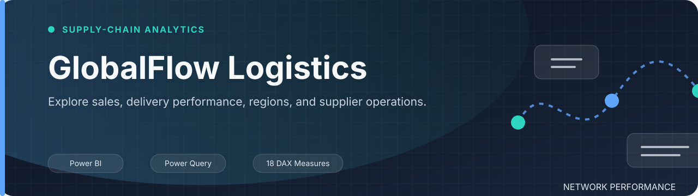
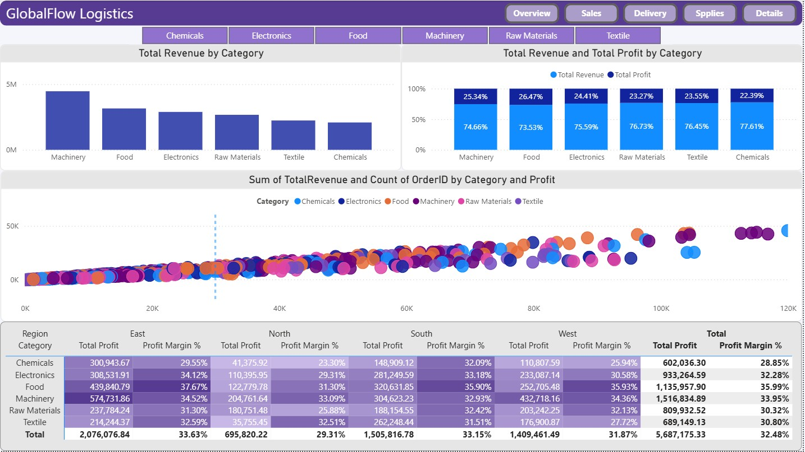
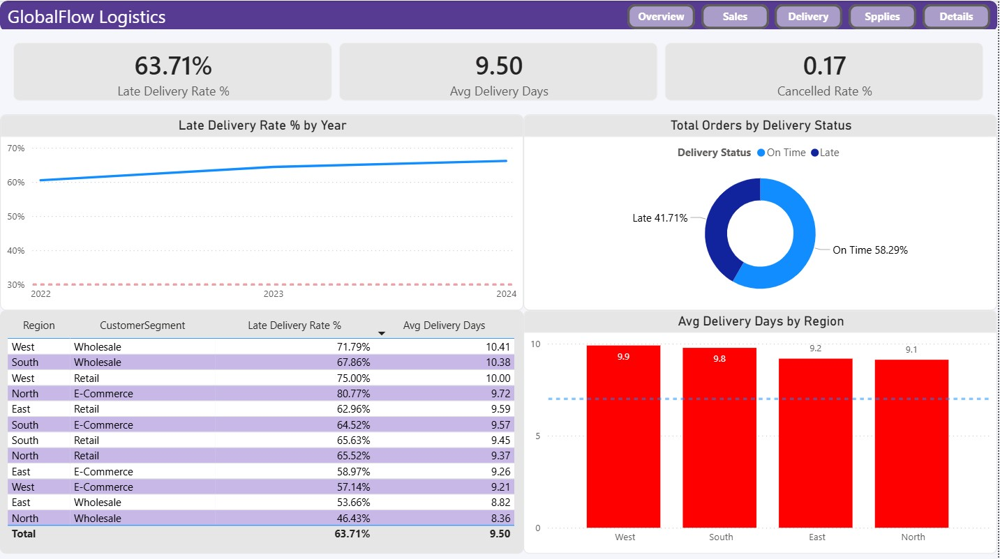
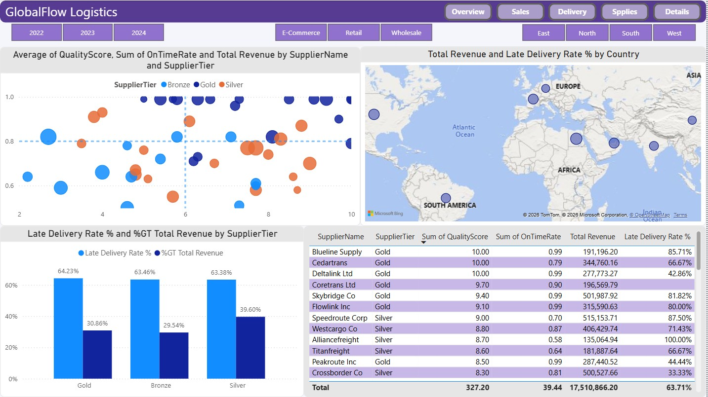
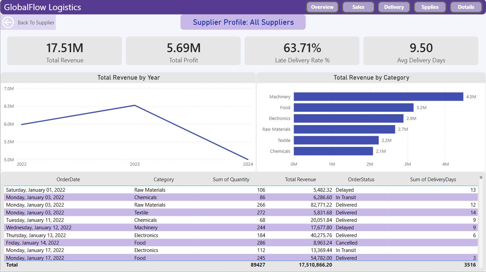

<div align="center">



# GlobalFlow Logistics

**Supply-chain analytics · Power BI · 2022–2024**

   

</div>

---

## Dashboard walkthrough

<table>
<tr>
<td width="50%"><br><sub><b>01 · Executive overview</b> — revenue, orders, segments, regional mix</sub></td>
<td width="50%"><br><sub><b>02 · Sales analysis</b> — category profitability and order detail</sub></td>
</tr>
<tr>
<td width="50%"><br><sub><b>03 · Delivery performance</b> — late rates and delivery duration</sub></td>
<td width="50%"><br><sub><b>04 · Supplier analysis</b> — quality and on-time performance</sub></td>
</tr>
<tr>
<td width="50%"><br><sub><b>05 · Supplier profile</b> — drill-through supplier performance</sub></td>
<td width="50%"></td>
</tr>
</table>

---

## Scope

- Orders from 2022-01-01 to 2024-12-29, across 4 regions (East, North, South, West) and 3 customer segments (E-Commerce, Retail, Wholesale).
- 80 products in 6 categories and 50 suppliers in 3 tiers (Gold, Silver, Bronze).
- Report totals: 585 orders, 17.51M revenue, 5.69M profit, 32.48% profit margin. Cost includes shipping.

## Report pages

| # | Page | Purpose |
|---|---|---|
| 1 | Overview | KPI cards, revenue by customer segment, orders by region, revenue and year-over-year growth |
| 2 | Sales | Revenue and profit by category, category by region profit matrix, order-level scatter |
| 3 | Delivery | Late delivery rate, average delivery days, delivery status, late rate by region and segment |
| 4 | Suppliers | Quality score and on-time rate by supplier, late rate by country and tier |
| 5 | Details | Drill-through supplier profile with revenue trend and order list |

Each page has region, segment and year slicers and navigation buttons. More screenshots are in [`screenshots/`](screenshots/). A screen recording is in [`demo/`](demo/dashboard-walkthrough.mp4).

## Data model

Star schema. `Orders` is the fact table. `Products`, `Suppliers` and `Calender` are the dimensions, joined on `ProductID`, `SupplierID` and `OrderDate`.

## Data cleaning

`data/Orders.csv` has 600 rows. 15 of them have the order status `test`. The report shows 585 orders.

## DAX measures

The model has 18 measures, including:

- Time intelligence: `Revenue LY`, `YoY Revenue Growth %`, `Revenue MTD`, `Revenue 3M Avg`
- Financial: `Total Revenue`, `Total Cost` (product cost plus shipping), `Total Profit`, `Profit Margin %`, `Avg Order Value`
- Delivery: `Late Deliveries`, `Late Delivery Rate %`, `Avg Delivery Days`, `Cancelled Rate %`
- Suppliers: `Supplier Quality Index` (quality score multiplied by on-time rate)
- Presentation: conditional bar color (red when average delivery days is above 7) and a dynamic supplier page title

## Files

```
dashboard/   Power BI report (.pbix)
data/        Source CSV files (Orders, Products, Suppliers)
screenshots/ One image per report page
demo/        Screen recording of the report
```

To open the report, use Power BI Desktop. If the data source path is broken on your machine, update it in Transform data > Data source settings and point it to the `data/` folder.

## Data note

The dataset is synthetic (generated product and supplier names, plus test rows). It contains no real company data.

## Author

Eslam TagElsir. [LinkedIn](https://www.linkedin.com/in/eslam-tagelsir) · [GitHub](https://github.com/EslamTagElsir)
